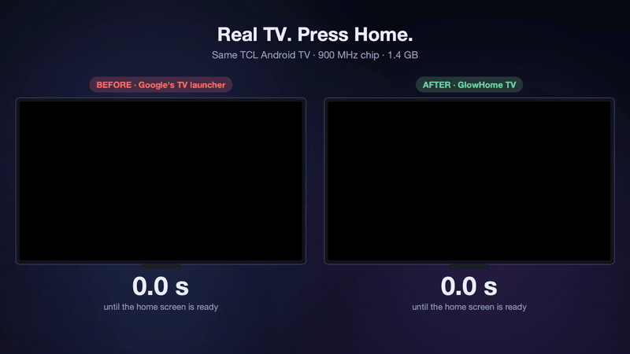
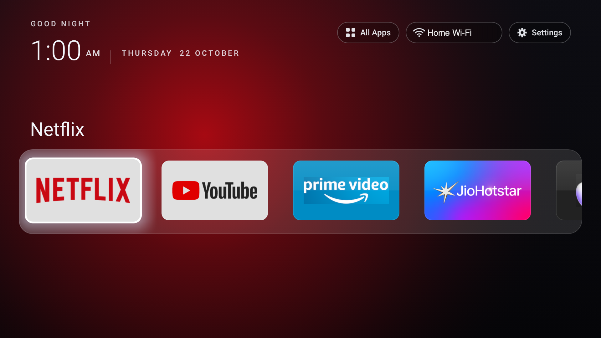

# GlowHome TV

*Formerly **Aura TV**. Same app, new name (another launcher is called "Aura"). It updates in place and keeps your settings.*

**A fast, minimal home screen (launcher) for Android TV and Amazon Fire TV.**

GlowHome TV replaces your TV's cluttered home screen with one clean row of the apps you actually use.
It has no ads, no accounts and no tracking. It is built to stay quick on slow, cheap TV chips.

### ⬇ [Download GlowHomeTV.apk](https://github.com/sahil4512/glowhome-tv-launcher/releases/latest/download/GlowHomeTV.apk)

On the TV, open the free **Downloader** app and enter the code:

## `8015828`

Or type the full address (both always get the newest version):

```
https://github.com/sahil4512/glowhome-tv-launcher/releases/latest/download/GlowHomeTV.apk
```

The old code `1212393` and the old address ending in `AuraTV.apk` still work too.

Step-by-step: [Quick install (no computer)](#quick-install-no-computer) ·
[Full setup with a computer](#full-setup-with-a-computer)

[](https://github.com/sahil4512/glowhome-tv-launcher/releases/download/v0.7.0/glowhome-tv-promo.mp4)

▶ **[Watch the 45-second video](https://github.com/sahil4512/glowhome-tv-launcher/releases/download/v0.7.0/glowhome-tv-promo.mp4)**



- **Small and light.** About 1.3 MB to download and about 27 MB of memory while running. It uses
  no CPU while idle on the home screen.
- **Tunes itself to your TV.** On first start, GlowHome checks your TV's memory and processor. On a
  slow or low-memory TV it picks the lightest setup by itself.
- **Works with any standard remote.** Arrows, Select, Back, Home and Menu are all you need.
- **Private.** No accounts, telemetry or ads. The only time it uses the internet is for the
  optional screensaver photo (see [Privacy](#privacy)).
- **Open source** under the [MIT license](LICENSE).

---

## Contents

- [Which TVs it works on](#which-tvs-it-works-on)
- [Install it on your TV](#install-it-on-your-tv)
- [Make GlowHome your home screen](#make-glowhome-your-home-screen)
- [Clean up your TV (optional)](#clean-up-your-tv-optional)
- [Using GlowHome](#using-glowhome)
- [Settings](#settings)
- [How GlowHome stays fast](#how-glowhome-stays-fast)
- [Privacy and permissions](#privacy)
- [Troubleshooting](#troubleshooting)
- [Uninstall](#uninstall)
- [Build it yourself](#build-it-yourself)
- [Project layout](#project-layout)

---

## Which TVs it works on

Any TV running **Android 5.1 or newer** (API 22+), including Android TV, Google TV and Amazon Fire
TV (Fire OS 5 and newer). It has been tested on:

| TV | System | Result |
|---|---|---|
| Amazon Fire TV Stick 4K (1st gen) | Fire OS 6 (Android 7.1) | Works. Home button needs the built-in redirect (see below) |
| TCL Android TV (Realtek chip, 720p) | Android TV 9 | Works. Picked the light setup by itself |
| Android TV emulator | Android 7.1 to 16 | Full automated test suite |

If you try it on another TV, please open an issue and say how it went.

---

## Install it on your TV

There are two ways. **Quick install** needs only the TV and its remote. **Full setup** uses a
computer and also tunes, precompiles and measures GlowHome on your TV in one go.

### Quick install (no computer)

The ready-to-install APK is always at this address (it points to the newest version):

```
https://github.com/sahil4512/glowhome-tv-launcher/releases/latest/download/GlowHomeTV.apk
```

1. Install the free **Downloader** app (by AFTVnews) from the Amazon Appstore or Google Play.
2. Allow it to install apps:
   - **Fire TV:** Settings → My Fire TV → Developer options → Install unknown apps → Downloader → On.
     (If Developer options is missing: My Fire TV → About, select the device name 7 times.)
   - **Android TV / Google TV:** Settings → Apps → Security & restrictions → Unknown sources →
     Downloader → On. (On some TVs: Settings → Device Preferences → Security & restrictions.)
3. Open Downloader, enter the code **8015828** (or the address above), and choose **Install**
   when it finishes downloading.
4. Open **GlowHome TV**. It checks your TV and picks the right setup by itself on first start.

Then see [Make GlowHome your home screen](#make-glowhome-your-home-screen).

Android compiles GlowHome for your TV's chip on its own while the TV is idle, usually within a day,
so it gets a little faster after the first day. The full setup below does that immediately.

### Full setup (with a computer)

#### 1. Turn on developer options on the TV

- **Fire TV:** Settings → My Fire TV → About. Select the device name 7 times. Then go back to
  My Fire TV → Developer options and turn on **ADB debugging**.
- **Android TV / Google TV:** Settings → Device Preferences → About. Select **Build** 7 times.
  Then go back to Device Preferences → Developer options and turn on **USB debugging** (it also
  covers network debugging on most TVs).

#### 2. Find the TV's IP address

- **Fire TV:** Settings → My Fire TV → About → Network.
- **Android TV:** Settings → Network & Internet → your Wi-Fi network.

It looks like `192.168.1.50`. Below, replace `<tv-ip>` with it.

#### 3. Install adb on your computer

- **macOS:** `brew install android-platform-tools`
- **Windows / Linux:** download [Android SDK Platform-Tools](https://developer.android.com/tools/releases/platform-tools)
  and unzip it.

#### 4. Download GlowHome

Get the newest `GlowHomeTV-x.y.z.apk` from the [Releases](../../releases) page and put it in this
repo's `dist/` folder (or anywhere you like). Older releases named it `AuraTV-x.y.z.apk`; both names work. Each release also lists the file's SHA-256, so you
can check it downloaded correctly:

```bash
shasum -a 256 dist/GlowHomeTV-*.apk
```

#### 5. Install with one command

```bash
tools/aura-setup <tv-ip>:5555
```

The first time, the TV asks **"Allow USB debugging?"**. Choose *Always allow from this computer*
and select OK. Then `aura-setup`:

1. **Checks that the TV is free.** If something is playing, or an app other than the home screen
   or Settings is open, it stops without changing anything.
2. **Looks at the TV** (read-only): model, Fire OS or Android TV, Android version, memory, CPU
   speed, graphics, screen, current home app, and any GlowHome already installed.
3. **Shows the plan** for this TV, including which setup GlowHome will pick (Light or Standard, see
   [How GlowHome stays fast](#how-glowhome-stays-fast)), and asks before installing.
4. **Installs** the newest APK from `dist/`. It never uninstalls or disables anything else.
5. **Precompiles** GlowHome so it opens faster (Android 7 and newer).
6. **Asks about the optional steps:** usage access for the Fire TV Home button, or making GlowHome the
   Home app on Android TV (just press Enter: the answer defaults to yes). Nothing happens without your yes.
7. **Measures** launch time, memory, idle CPU and stutter, and saves a report in `reports/`.
   If something isn't right on your TV, attach that report to a GitHub issue.

Just want to see what it would do? Add `--check-only`, which changes nothing on the TV but still saves the report. `--help` lists all
options. It needs only Python 3 (built into macOS and Linux) and adb.

Without the script, the same install by hand:

```bash
adb connect <tv-ip>:5555
```
```bash
adb -s <tv-ip>:5555 install -r GlowHomeTV-x.y.z.apk
```
```bash
adb -s <tv-ip>:5555 shell cmd package compile -m speed -f com.auratv.launcher
```


---

## Make GlowHome your home screen

### Android TV / Google TV

**GlowHome asks you itself.** The first time you open it, GlowHome shows *Make GlowHome your home screen* and
does the most your TV allows. Android never lets an app make itself the home screen without you,
so you confirm once:

- **Android 10 and newer:** select *Make GlowHome my home screen*. In the TV's own dialog, select **GlowHome TV**, then *Set as default*.
- **Older Android TV:** GlowHome opens the TV's Home app settings, or the "which app?" chooser.
  Pick **GlowHome TV** (and *Always*).
- **TVs that never let you choose** (stock Google TV launchers that always win, and TVs whose maker
  locked the home screen): GlowHome says so and shows the one command that does it from a computer:
  ```bash
  tools/aura-setup <tv-ip>:5555 --set-home
  ```
  or, to also turn the TV's own home screen off (reversible): `tools/tv-cleanup <tv-ip>:5555 --apply --replace-home`.

*Not now* is remembered, and the prompt never comes back on its own. To do it later:
GlowHome **Settings → System → Make GlowHome Your Home Screen**. Until then GlowHome works as a normal app:
open it from the app list.

### Fire TV

Fire OS doesn't let you change the home screen. Pressing Home always starts Amazon Home first.
GlowHome has a **built-in Home button redirect** that brings GlowHome up instead. On first start GlowHome
explains this and can take you straight to its Home Button settings. The redirect is off until you
turn it on:

1. Give GlowHome permission to see which app is on screen (one time, from your computer; `aura-setup`
   offers to do this for you):
   ```bash
   adb -s <tv-ip>:5555 shell appops set com.auratv.launcher GET_USAGE_STATS allow
   ```
2. In Aura: **Settings → System → Home Button → Open GlowHome With the Home Button → On.**
3. Press Home. Amazon Home appears briefly, then GlowHome comes up.

What to expect:

- **There is a delay of about 5 seconds** after pressing Home. This is a protection built into
  Android: after Home is pressed, it holds back other apps from opening for 5 seconds. Every
  Fire TV launcher without root has the same delay. Backing out of an app to Amazon Home is
  redirected almost instantly (about 0.2 s).
- **To get to Amazon Home on purpose,** press Home twice (within 3 seconds of GlowHome appearing), or
  use Settings → System → Home Button → *Open Amazon Home*.
- **Amazon's own Settings screens are never redirected,** so you can still use them normally.
- **If you use Launcher Hijack** or a similar app, turn one of the two off. Two redirects fight
  each other. GlowHome warns you if it finds one.

The redirect runs as a tiny separate process (about 7 MB), stops completely while the screen is
off, and has loop protection (it pauses itself if it ever redirects too often).

**Experimental instant mode** (Settings → Home Button → Experimental) uses Android's
accessibility service to catch the Home button itself, which removes the 5-second delay. Most
Fire OS versions block this, so it may do nothing on your TV. If it does work, holding Home opens
Amazon Home.

---

## Clean up your TV (optional)

Many TVs ship with services you never asked for: usage tracking, ad and promo rows, partner apps
installed after setup, and extras like discontinued Google apps. On a slow TV they use memory and
CPU in the background. `tools/tv-cleanup` turns them off.

```bash
tools/tv-cleanup <tv-ip>:5555
```

On its own it's only a **preview**: it lists what it would turn off on *your* TV, and what each
one does. Nothing changes until you add `--apply`:

```bash
tools/tv-cleanup <tv-ip>:5555 --apply
```

- **Safe** ones (telemetry, promos, unused extras) are turned off after one yes.
- **Optional** ones cost a feature, so you're asked about each, for example *"Google voice search:
  the remote's mic button stops working"* or *"Chromecast built-in: you can't cast"*.
- **The TV's own home screen** is only turned off with `--replace-home`, and only if GlowHome then
  really becomes Home. If it doesn't, it's turned straight back on.
- **Never touched:** Settings, the system UI, Google Play and its services, the keyboard you use,
  and anything not on the [reviewed list](tools/cleanup/packages.txt).

Everything is **turned off, not uninstalled**. To undo all of it:

```bash
tools/tv-cleanup <tv-ip>:5555 --restore
```

Each run also saves a restore script in `reports/`. Restart the TV afterwards to free the memory.

On **Fire TV**, Fire OS doesn't let apps turn off Amazon's system apps without root, so the tool
just says so. There, uninstall apps you don't use in Settings → Applications.

The list currently covers TCL and Google's Android TV packages, all turned off on a real TCL TV.
Know another brand's bloat? Add it to [packages.txt](tools/cleanup/packages.txt) with what it
does and what turning it off costs, and open a pull request.

---

## Using GlowHome

| Remote button | What it does on the home screen |
|---|---|
| ◀ ▶ | Move between apps |
| ▲ ▼ | Move between rows and the top bar (All Apps, Wi-Fi, Settings) |
| Select | Open the app |
| **Hold Select** or **≡ Menu** on an app | App options: Open, Move, Add or remove favourite, Hide, App info, Uninstall |
| ≡ Menu on a top-bar button | GlowHome's settings |
| Back | Closes menus. On the home screen it jumps back to the first app |

- **Add an app to Home:** open **All Apps**, hold Select on the app, choose *Add to Favourites*.
  New TV apps you install are added automatically (you can turn this off).
- **Reorder:** hold Select on a favourite, choose **Move**, use ◀ ▶, then press Select.
- **Hide an app:** hold Select, then *Hide from Home*. Find it again under Settings → Apps → Hidden
  Apps.
- **Home brings you back where you were.** When you return to GlowHome, the app you last opened is
  already selected.
- **The Settings button in the top bar opens your TV's own settings** (network, picture, sound).
  For GlowHome's settings, hold Select on that button, or press ≡ Menu while it is selected.

### Screensaver

GlowHome includes a screensaver that shows a photo of the day (from Bing, Wikipedia or NASA) with
the time, or GlowHome's own built-in artwork when offline. Choose **GlowHome TV** in your TV's
screensaver (Daydream) settings to use it. Photos are only downloaded if GlowHome is actually your
chosen screensaver.

---

## Settings

| Section | What's in it |
|---|---|
| **Appearance** | 5 themes (Midnight, Minimal Dark, Soft Glass, Cinematic, Warm Ambient), accent colour, clock and date, 12/24-hour, greeting, background (Solid or Ambient glow) |
| **Apps** | Favourites, hidden apps, auto-add new apps, show system utilities, All Apps order, refresh app list, reset favourites |
| **Layout** | One favourites row or an All Apps grid, tile size, row position, Recently Used row, extra All Apps row, animation speed (Relaxed / Normal / Quick / Off) |
| **System** | TV settings shortcut, Make GlowHome Your Home Screen (Android TV) or Home Button (Fire TV), **Keep the TV Light**, backup / restore, reset |
| **About** | Version, your TV model, how long Home took to start, memory in use, and how GlowHome tuned itself for this TV |

**Keep the TV Light** (on by default): a few seconds after you open an app from GlowHome, GlowHome closes
other apps that are sitting in the background using memory, for example Netflix's background
service. The app you are watching is never touched, and neither are system apps. This makes a big
difference on TVs with little memory. It has no effect on Android 14 and newer, which don't allow it.

**Backup:** Settings → System → Back Up Settings saves your setup as `YYYYMMDD_aura-backup.json`
(for example `20261126_aura-backup.json`): on the TV, on a USB drive or SD card, or in a shared folder
on your network (a computer or NAS, SMB 2/3). *Restore From Backup* lists the backups there, newest
first, and reads the one you pick back in, for example after reinstalling or on a second TV. On a USB
drive or SD card the backup goes to `AuraTV` at the top of the drive when the TV allows it, otherwise
to GlowHome's own folder there (`Android/data/com.auratv.launcher/files`); restore looks in both and
at the top of the drive. A second backup on the
same day replaces that day's file; `aura-backup.json` from earlier versions is still offered.

For a network share, GlowHome searches your network and lists the computers and NAS it finds, A–Z
(or choose *Enter Address*, such as `192.168.1.10` or `\\NAS\Backups`), then the shared folders. When a share asks for a
user name and password, *Remember this login* keeps them for next time: they are stored separately
from your settings (so a backup never contains them) and, on Android 6 and newer, encrypted with a
key kept in the Android Keystore. A saved login can be forgotten from the server's page.

---

## How GlowHome stays fast

Most TV launchers are slow because the TV's processor is slow. GlowHome is designed around that:

- **No heavy libraries.** It is written in Kotlin with Android's own built-in views only: no
  AndroidX, Leanback, Compose, WebView or Google Play Services.
- **Instant first screen.** The app list and app tiles are cached on disk, so Home shows real tiles
  immediately instead of waiting for Android to list every installed app.
- **Nothing moves while you're not using it.** The default background is a solid colour, so the
  screen isn't redrawn while idle (0 % CPU). On the TCL TV, a moving wallpaper had cost about a
  quarter of one processor core all the time.
- **Tunes itself on first start.** If the TV is in Android's low-memory mode, has under 2 GB of
  memory, or a processor at 1.2 GHz or slower, GlowHome picks the solid background, quick animations
  and Keep the TV Light. Settings → About shows what it chose. You can change any of it.
- **Precompiled code.** `tools/aura-setup` asks Android to compile all of GlowHome ahead of
  time (`cmd package compile -m speed`). On a slow TV chip this made GlowHome open about 20 % faster.
  Android undoes this on every update, so the script does it again on every install.

### Measured on a real TV

TCL Android TV 9 with a 4 × 900 MHz Realtek chip, 1.4 GB of memory, 720p
([full report](docs/perf-tcl-tv.md)):

| | Before tuning (0.5.1) | **Now (0.6.3+)** |
|---|---|---|
| GlowHome opening from cold | 587–802 ms | **271–286 ms** |
| Returning to Home | 350 ms | **179 ms** |
| CPU while idle on Home | ~26 % of a core | **0 %** |
| Memory | 38.2 MB | **26.5 MB** |
| Stuttering frames while navigating | 9.6 % | **1.8 %** |

Check it on your own TV:

```bash
adb -s <tv-ip>:5555 shell am start -W -n com.auratv.launcher/.ui.MainActivity
```
```bash
adb -s <tv-ip>:5555 shell dumpsys meminfo com.auratv.launcher
```

`tools/tv_monitor.py <tv-ip>:5555` opens a live, read-only view of the TV's CPU and memory use
per app in your browser (at http://localhost:8765).

---

## Privacy

GlowHome has no accounts, analytics, ads or crash reporting, and sends nothing about you anywhere.

**Network:** the only network use is the screensaver's photo of the day (Bing, Wikipedia or
NASA), and only while GlowHome is your chosen screensaver.

**Why each permission is needed:**

| Permission | Used for |
|---|---|
| Usage access (`PACKAGE_USAGE_STATS`) | The Fire TV Home button redirect, and the Recently Used row. Granted by you over adb; GlowHome works without it |
| Accessibility service | Only the experimental instant Home button mode on Fire TV. Off unless you turn it on |
| Location (`ACCESS_COARSE_LOCATION`) | Only to show your Wi-Fi network's name in the top bar (Android 8.1+ requires it for that). GlowHome never reads your location. Say no and the chip just shows "Wi-Fi" |
| Close background apps (`KILL_BACKGROUND_PROCESSES`) | Keep the TV Light |
| Storage | Backup and restore of GlowHome's settings |
| Start at boot, foreground service | Restarting the Home button redirect after the TV restarts, only if you turned it on |
| Internet | The screensaver photo, and backing up to / restoring from a shared folder on your network when you choose it |
| Wi-Fi multicast (`CHANGE_WIFI_MULTICAST_STATE`) | Finding computers and NAS with shared folders while that list is open |

---

## Troubleshooting

| Problem | Fix |
|---|---|
| `adb connect` fails | Check the IP, that the computer and TV are on the same network, and that ADB / USB debugging is on. Some TVs need the "Allow USB debugging?" prompt answered on screen |
| Install fails with a signature error | A copy signed with a different key is installed. Uninstall it first (see [Uninstall](#uninstall)) |
| Fire TV: Home still opens Amazon Home | Settings → System → Home Button must be **On** and *Usage access* must say *Granted* (run the `appops` command above) |
| Fire TV: Home takes about 5 seconds | Expected; see [Fire TV](#fire-tv). Try instant mode |
| Fire TV: Home flips between two launchers | Another redirect app (Launcher Hijack, etc.) is running. Turn one off |
| An app is missing | It may be hidden (Settings → Apps → Hidden Apps), or turn on *Show System Utilities*, or choose *Refresh App List* |
| An icon looks wrong after an app update | Settings → Apps → *Refresh App List* |
| Navigation feels slow | Settings → Layout → Interface Animation → *Quick*, and Appearance → Background → *Solid* |

---

## Uninstall

1. On Fire TV, turn the redirect off first: Settings → System → Home Button → Off.
2. Remove GlowHome from the TV's app settings, or from your computer:
   ```bash
   adb -s <tv-ip>:5555 uninstall com.auratv.launcher
   ```

GlowHome never changes system settings or other apps, so nothing else needs undoing.

---

## Build it yourself

You need **JDK 17** and the **Android SDK** (platform 36). The easiest way is to install
[Android Studio](https://developer.android.com/studio), which includes both. Then create
`local.properties` with your SDK path, for example `sdk.dir=/Users/you/Library/Android/sdk`.

Build and run the unit tests:

```bash
./gradlew testDebugUnitTest assembleRelease
```

The APK is written to `app/build/outputs/apk/release/app-release.apk`.

**Signing.** Release builds use your own key in `keystore/`, which is never committed. Create one
once with:

```bash
AURA_KEY_PASSWORD='choose-a-password' tools/make-keystore.sh
```

Without a key, release builds are signed with the Android debug key so the build still works.
**Keep your `keystore/` folder safe and backed up.** Android only installs an update over an
existing copy if it was signed with the same key. Builds from different people's keys can't
update each other; uninstall first when switching.

### Tests

| What | Command | Where it runs |
|---|---|---|
| Unit tests (68) | `./gradlew :app:testDebugUnitTest` | Your computer |
| Remote navigation, layout and memory-leak checks | `tools/ui_check.py` | Android TV emulator only |
| Before / after performance | `tools/perf_compare.py` | Emulator only |
| Home redirect and boot | `tools/redirect_check.py` | Emulator only |
| Tile cache and boot resources | `tools/resource_check.py` | Rootable emulator only |
| Upgrade over an older version | `tools/upgrade_check.py` | Rootable emulator only |

The Python scripts explain their options with `--help`. The emulator-only scripts refuse to run against
a real TV. The UI checks need the debug build and the test apps:

```bash
./gradlew :app:assembleDebug :testfixture:assembleDebug
```
```bash
tools/ui_check.py --serial emulator-5554 --apk app/build/outputs/apk/debug/app-debug.apk --fixture testfixture/build/outputs/apk --out /tmp/aura-ui
```

`testfixture/` builds about 20 tiny test apps (long names, bright and dark banners) used only by
these checks. It is never part of GlowHome itself.

The built-in artwork, app icon and banner are drawn by code, so there are no image licensing
questions. To regenerate them:

```bash
java -Djava.awt.headless=true tools/AuraArt.java app/src/main
```

---

## Project layout

```
app/src/main/java/com/auratv/launcher/
  AuraApp.kt                  app start: settings, app list, tile cache, install/uninstall events
  apps/                       finding apps, ordering, tiles and their cache, recent apps, Keep the TV Light
  redirect/                   Fire TV Home button redirect, boot receiver, instant mode
  screensaver/                photo-of-the-day screensaver
  settings/                   saved settings, themes, DeviceProfile (per-TV tuning)
  ui/                         home screen, rows, grid, All Apps, menus, settings screens, focus style
  wallpaper/                  backgrounds and built-in artwork
  util/                       start-up timing, small helpers
app/src/test/                 unit tests
testfixture/                  test apps for the emulator checks
tools/                        aura-setup, tv-cleanup (+ cleanup/packages.txt), test harnesses, TV monitor, artwork generator
docs/                         screenshots and measurement reports
```

See [CHANGELOG.md](CHANGELOG.md) for what changed in each version.

## License

[MIT](LICENSE). GlowHome TV is an independent project, not affiliated with Amazon, Google or any TV
maker. App names and logos shown in screenshots belong to their owners.
